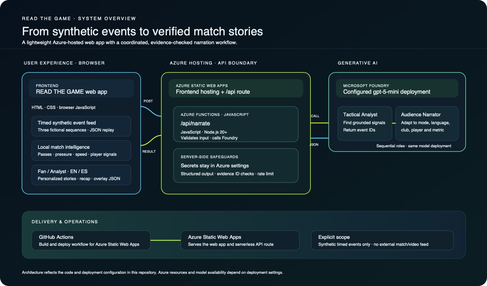
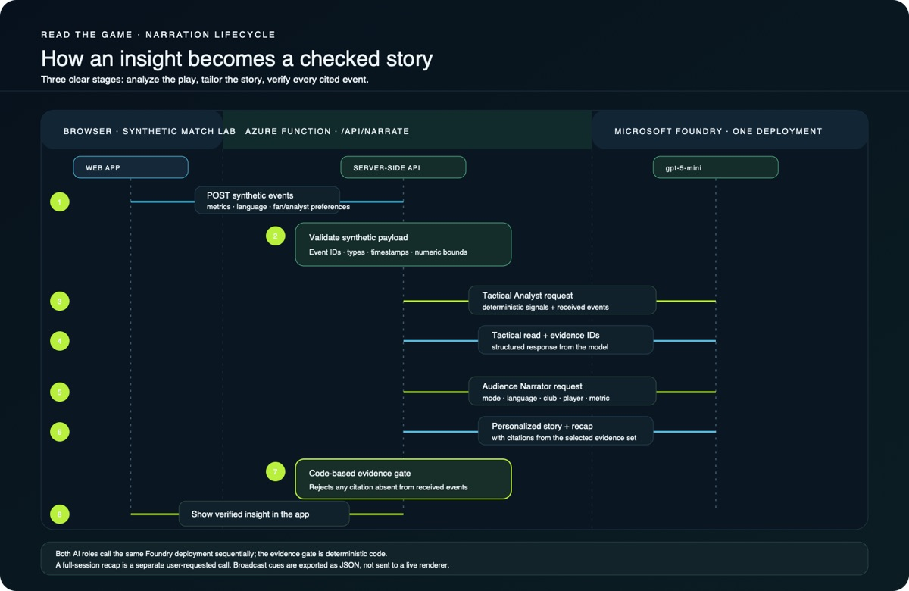

# READ THE GAME

Read the Game is a bilingual match intelligence workspace for fictional football events. It reconstructs the action, calculates football signals, explains why they matter, and turns selected moments into timed, machine-readable overlay cues.

**Live web app:** [Open READ THE GAME on Azure](https://delightful-forest-0a04ede10.2.azurestaticapps.net/)

**Demo video:** [Watch READ THE GAME on YouTube](https://youtu.be/bTZP2mEAM3E)

## Contents

1. [Architecture and workflow](#how-it-is-built)
   1. [Architecture diagram](#architecture)
   2. [Narrative and evidence workflow](#narrative-and-evidence-workflow)
2. [Languages and technologies](#languages-and-technologies)
3. [What the app does](#what-works-in-this-version)
4. [Honest scope and limitations](#honest-scope)
5. [Run locally](#run-it-locally)
6. [Microsoft Foundry and Azure setup](#microsoft-foundry-and-azure)
7. [Event data schema](event-schema.json)
8. [Narration API documentation](api/README.md)
9. [Project pitch and submission links](PROJECT_PITCH.md)
10. [Remaining submission steps](#still-needed-for-the-hackathon-submission)

## How it is built

The diagrams below document the implementation in this repository. The browser creates and replays synthetic events; Azure Static Web Apps hosts the frontend and the `/api/narrate` Azure Function; that function coordinates two role-based requests to the configured Microsoft Foundry deployment and checks the returned event references in code. The app does not use Cosmos DB, Azure Container Apps, an external live match feed, or video auto-eventing.

### Architecture

### Narrative and evidence workflow

The editable vector sources are also available as [architecture](docs/architecture.svg) and [narrative workflow](docs/match-flow.svg).

## Languages and technologies

- **Frontend:** HTML, CSS, and browser JavaScript (`index.html`, `styles.css`, `app.js`); no frontend framework.
- **Backend:** JavaScript on Node.js (the API package targets Node.js 20 or later), running as an Azure Functions endpoint at `/api/narrate`.
- **Microsoft/Azure:** Azure Static Web Apps, Azure Functions, and Microsoft Foundry with the configured `gpt-5-mini` deployment.
- **Deployment:** GitHub Actions workflow for Azure Static Web Apps.

The event sequences and most match calculations run in the browser. The backend validates inputs, requests model analysis and audience-specific narration, and checks event citations. The project does not use a database in this version.

## What works in this version

- Three repeatable tactical patterns: a diagonal outlet, a central overload, and a wide escape. Each pattern has its own player routes, question, evidence, and generated recap.
- A synthetic event feed that arrives in timed steps and updates the pitch, event list, metrics, story, and recap as each event lands.
- Import of structured synthetic event JSON, with validation that rejects real/non-synthetic labels, unknown event types, teams, or roster names; imported events replay through the same feed.
- Fictional player identification by name, number, position, and team. Player top speed is surfaced above a 25 km/h threshold.
- Pass distance and completion, illustrative pass difficulty, estimated ball and shot speed, and qualitative sequence control, pressure, and rhythm.
- Evidence-linked explanations, a transparent “what if” route estimate, and a full synthetic-session recap spanning every received sequence. The recap is generated locally by default and can be explicitly expanded with Foundry; referenced event IDs are validated against the received feed.
- Fan and analyst modes, Spanish and English, and saved preferences for team, player, and metric.
- Broadcast-mode preview of timestamped, prioritized overlay cues, plus a dedicated machine-readable JSON export linked to synthetic event IDs.
- A coordinated narrative workflow: deterministic signal detection, a Foundry Tactical Analyst, a Foundry Audience Narrator personalized for Fan/Analyst and saved preferences, then a code-based evidence gate. The narrator can cite only events selected by the tactical stage, and the API rejects unsupported references.
- Azure Static Web Apps hosting and an Azure Functions endpoint for Microsoft Foundry narration. The frontend never receives the Foundry key; check the deployed `/api/narrate` status and run a live request to verify the current Azure settings.

## Honest scope

The app uses only fictional, football-realistic events. It does not ingest an external match feed, analyze video, or identify real players from broadcast footage. Its “live” mode is a timed synthetic event stream and its recap covers the received session, not a real or full 90-minute match. Broadcast mode exports cue data; it is not connected to a live video or production renderer. Speed values and tactical difficulty are illustrative calculations from the supplied synthetic positions, not official tracking data. The coordinated workflow makes two model calls to the same Foundry deployment per generated narration or recap; automatic narration is limited to one request per key moment in each sequence, with a separate request only when a user explicitly generates a session recap. Confirm Foundry availability at `/api/narrate` and verify a real response in the deployed environment. No Premier League match data or imagery is included.

The hackathon description says video auto-eventing is a feature to consider; it is not stated as a must-have. A real Foundry narration has been verified in the deployed app. The public demo video is available on YouTube; the remaining submission step is to add the project details, repository, and video URL to the hackathon project page. The bilingual pitch naming the technologies actually used is in [PROJECT_PITCH.md](PROJECT_PITCH.md).

## Run it locally

Open index.html in a modern browser. Press **Start synthetic feed** to watch events arrive. **New sequence** rotates through the three tactical patterns. You can replay the timeline, switch Fan/Analyst and Spanish/English, follow a fictional player, compare the what-if route, and download event JSON after at least one event arrives. Use **Load JSON events** to ingest an exported synthetic event envelope and replay it. Opening the HTML file directly uses the deterministic local explanation; the Azure Functions API runs only in an Azure Static Web Apps / Functions environment. Run `node --test api/narrate/index.test.js` from the repository root to exercise the API contract with a mocked model response; this does not call Foundry or consume tokens.

## Microsoft Foundry and Azure

The Azure Static Web App serves the frontend and `/api/narrate` Azure Function. Foundry settings are server-side production environment variables:

- AI_PROVIDER = foundry
- FOUNDRY_ENDPOINT = the Foundry project endpoint
- FOUNDRY_API_KEY = the secret key
- FOUNDRY_DEPLOYMENT = gpt-5-mini

Never put the key in browser code, GitHub files, screenshots, or chat. The GET endpoint at `/api/narrate` reports whether settings are present; test an actual narration and verify its evidence references against received event IDs. Session recap requests support up to 40 events. See api/README.md for configuration and cost details.

## Still needed for the hackathon submission

- Include the verified live narration in the demo; the session recap feature is available and should be shown with its evidence references.
- Test the website at desktop and mobile widths and test JSON import/export in a browser.
- Review the bilingual pitch in [PROJECT_PITCH.md](PROJECT_PITCH.md) and use the appropriate version on the hackathon project page.
- The public demonstration video is published on YouTube: [Watch the demo](https://youtu.be/bTZP2mEAM3E).
- Add the public GitHub repository and the YouTube video URL to the hackathon project page.
